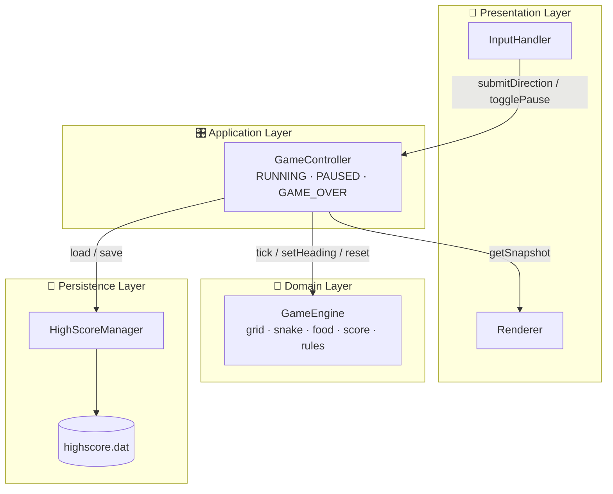
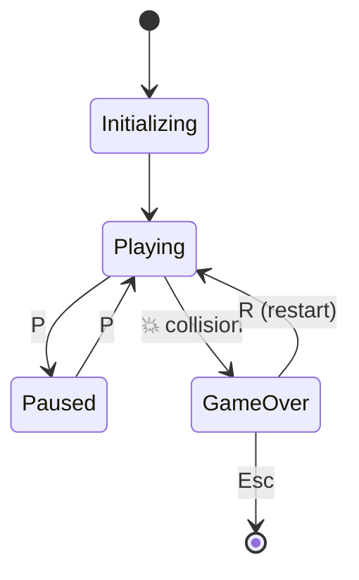

<div align="center">

```
 ███████╗███╗   ██╗ █████╗ ██╗  ██╗███████╗
 ██╔════╝████╗  ██║██╔══██╗██║ ██╔╝██╔════╝
 ███████╗██╔██╗ ██║███████║█████╔╝ █████╗  
 ╚════██║██║╚██╗██║██╔══██║██╔═██╗ ██╔══╝  
 ███████║██║ ╚████║██║  ██║██║  ██╗███████╗
 ╚══════╝╚═╝  ╚═══╝╚═╝  ╚═╝╚═╝  ╚═╝╚══════╝
        🐍 ■■■■■■■■■■■■■■■■■■■■■■■■■■■■■■■■■■■■■■■■■■■■ 🍎
```

### *Eat. Grow. Don't bite yourself. Repeat.*


**A classic single-player Snake game built with a properly engineered, four-layer architecture.**
*Because even a snake deserves an IEEE 1016 design spec.*

[🎮 Play](#-quick-start) · [🕹️ Controls](#️-controls) · [🏗️ Architecture](#️-architecture) · [🧪 Testing](#-testing) · [👥 Team](#-the-team)

</div>

---

## 🔥 What is this?

You're a snake. There's food. You eat it, you get longer, the board gets smaller, your ego gets bigger. One wrong turn into a wall (or into yourself) and it's over.

This isn't just a weekend hack. It's a full **Software Engineering mini-project** with an SRS (IEEE 830), an Architecture & Design Spec (IEEE 1016), and a Test Plan (IEEE 829), all traced requirement-to-test-case.

---

## ✨ Features

| | Feature | Details |
|---|---|---|
| 🟩 | **20×20 grid** | Snake spawns dead centre, length 3, heading right |
| 🍎 | **Smart food spawning** | Always lands on a free cell, within 100 ms |
| ⚡ | **Tunable speed** | 150 ms tick by default, adjustable from 80 to 300 ms |
| 🧠 | **No suicide U-turns** | Reversing direction is rejected, so no instant self-collision |
| 📈 | **Scoring** | +10 points and +1 length per bite, same tick |
| 💀 | **Collision detection** | Walls and your own tail are both fatal |
| ⏸️ | **Pause / Resume / Restart** | Full session control, no relaunch needed |
| 🏆 | **Persistent high score** | Saved locally with atomic writes so it can't get corrupted |
| 🛡️ | **Tamper-resistant** | High score is bounds-checked (0 to 999,999) and validated on load |
| 📖 | **On-screen controls** | Shown at launch, so no manual needed |

---

## 🚀 Quick Start

### Prerequisites
- A C++17 compiler (g++, clang++, or MSVC)
- [SFML 2.6+](https://www.sfml-dev.org/download.php)
- CMake 3.16+ (optional but recommended)

### Install SFML

```bash
# Ubuntu / Debian
sudo apt install libsfml-dev

# macOS
brew install sfml

# Windows
# Download from sfml-dev.org, or: vcpkg install sfml
```

### Build & Run

```bash
git clone https://github.com/<your-username>/snake-game.git
cd snake-game

mkdir build && cd build
cmake ..
cmake --build .

./snake      # 🐍 let's go
```

<details>
<summary><b>No CMake? Compile directly</b></summary>

```bash
g++ -std=c++17 src/*.cpp -o snake -lsfml-graphics -lsfml-window -lsfml-system
./snake
```
</details>

---

## 🕹️ Controls

| Key | Action |
|:---:|---|
| `↑` / `W` | Move up |
| `↓` / `S` | Move down |
| `←` / `A` | Move left |
| `→` / `D` | Move right |
| `P` | Pause / Resume |
| `R` | Restart (after Game Over) |
| `Esc` | Exit |

---

## 🏗️ Architecture

Strict **layered architecture**: four layers, five components, zero spaghetti.



**Why layered?**
- 🧩 **Separation of concerns.** Logic, rendering and input never touch each other directly (NFR-7).
- 🧪 **Testable core.** `GameEngine` runs with zero SFML dependencies, so it can be unit-tested on its own.
- 🔒 **Safe persistence.** File I/O happens only at startup and Game Over, using a temp file plus atomic rename.
- 👁️ **Read-only rendering.** `Renderer` only ever sees an immutable `GameSnapshot`.

### 🔄 Game State Machine



---

## 📊 Performance Targets

| Metric | Target |
|---|---|
| Frame redraw | ≤ 33 ms (~30+ FPS) |
| Full game tick | ≤ 50 ms |
| Food spawn | ≤ 100 ms |
| Crashes on bad input | **0** |

---

## 🧪 Testing

Tested at every level: **unit → integration → system → non-functional → security → acceptance**.

- ✅ **Positive & negative** cases for all 15 functional requirements
- 📏 **Boundary value analysis** on tick speed (80/300 ms), high score (0/999,999) and grid edges
- 🔁 **State-transition testing** across Initializing → Playing → Paused → Game Over → Restarted
- 🛡️ **Security tests** for corrupted, tampered or missing `highscore.dat`
- 🗺️ **Full Requirement Traceability Matrix** mapping every FR/NFR to its test cases

---

## 📚 Documentation

| Document | Standard |
|---|---|
| 📄 Software Requirements Specification | IEEE 830 |
| 🏛️ Software Architecture & Design Spec | IEEE 1016 + UML 2.x |
| 🧪 Software Test Plan | IEEE 829 |

---

## 🗺️ Roadmap

- [x] Core gameplay
- [x] Persistent high scores
- [x] Pause / restart
- [ ] 🎵 Sound effects
- [ ] 🌈 Skins & themes
- [ ] 🚧 Obstacle levels
- [ ] 🤖 AI snake that plays itself

---

## 👥 The Team

| Name | SRN |
|---|---|
| Nisarg Ravi | PES1UG25CS901 |
| Ramya H R | PES1UG25CS835 |
| Vinayaka Jagdish | PES1UG25CS855 |

*Built for **UE23CS341A: Software Engineering**, PES University.*

---

<div align="center">

### 🐍 *"It's not about the length of the snake. It's about how you avoid the walls."*

⭐ **Star this repo if it didn't bite you** ⭐

</div>
