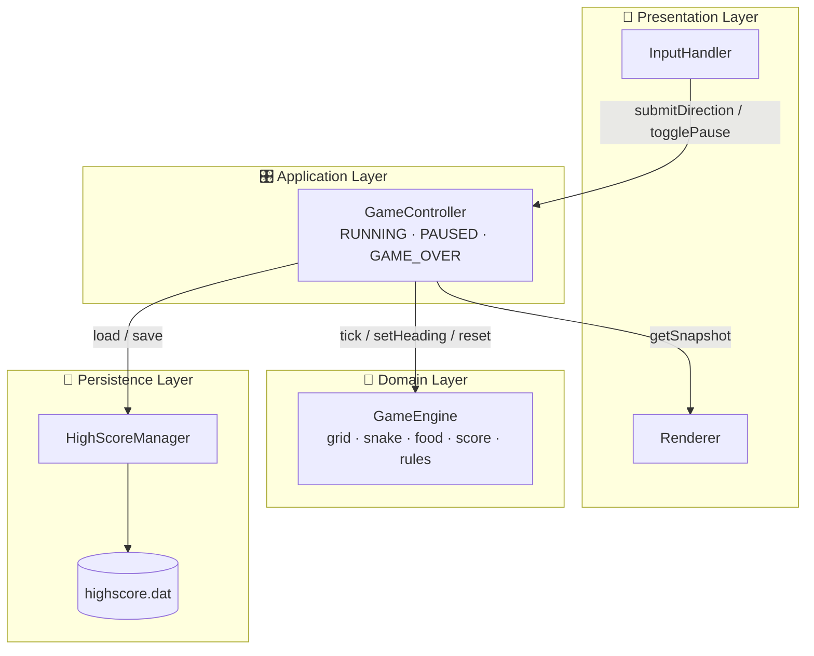
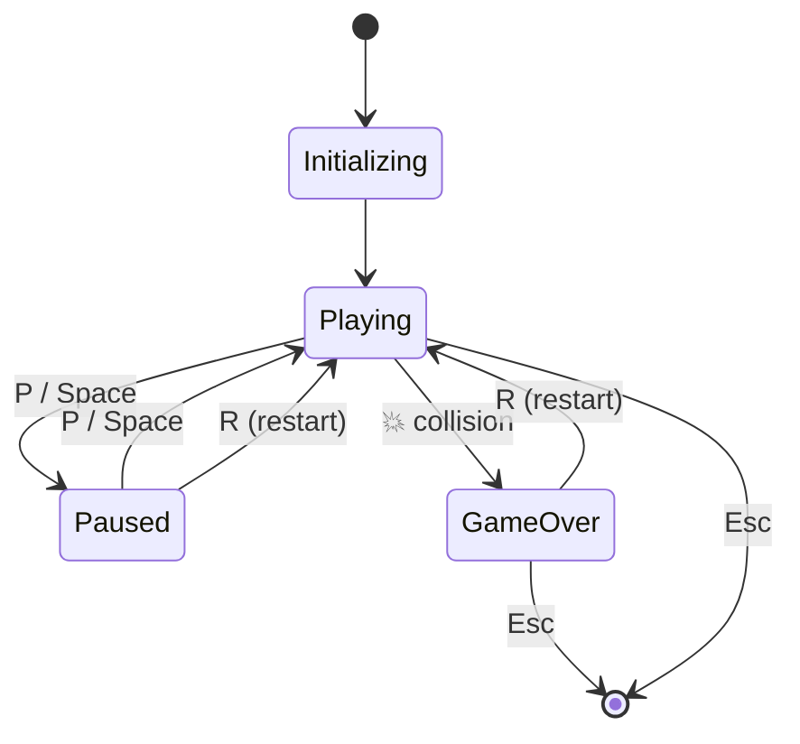
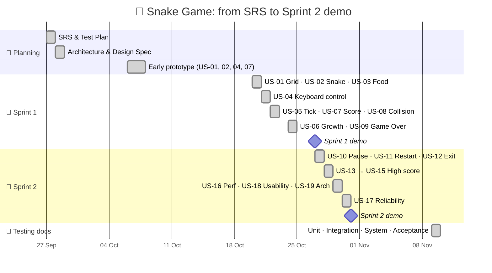
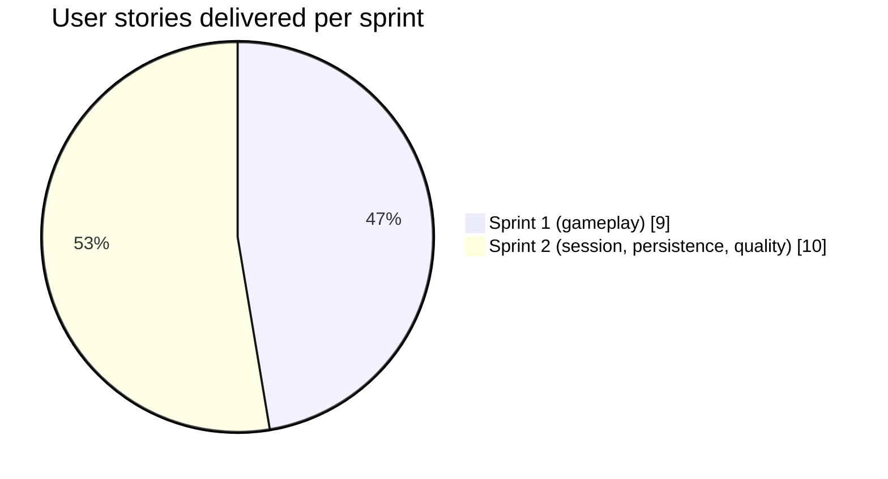
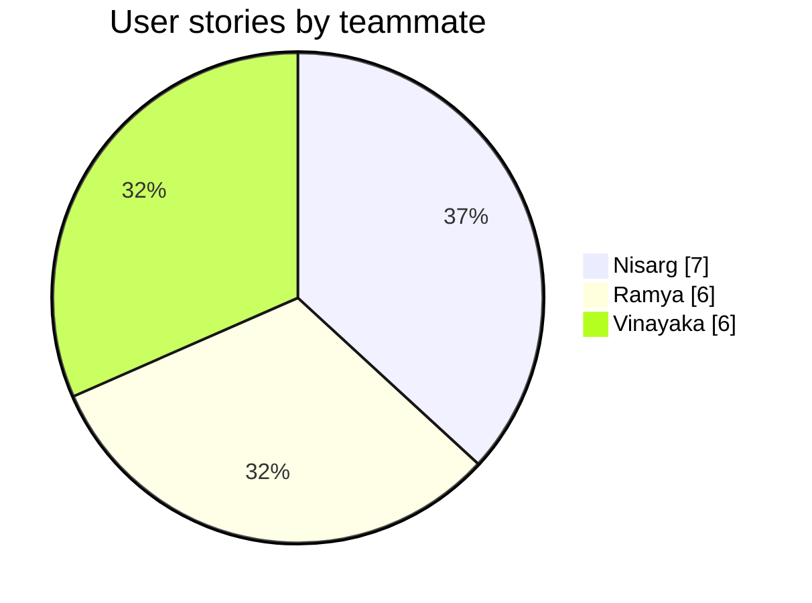

<div align="center">

```
 ███████╗███╗   ██╗ █████╗ ██╗  ██╗███████╗
 ██╔════╝████╗  ██║██╔══██╗██║ ██╔╝██╔════╝
 ███████╗██╔██╗ ██║███████║█████╔╝ █████╗  
 ╚════██║██║╚██╗██║██╔══██║██╔═██╗ ██╔══╝  
 ███████║██║ ╚████║██║  ██║██║  ██╗███████╗
 ╚══════╝╚═╝  ╚═══╝╚═╝  ╚═╝╚═╝  ╚═╝╚══════╝
        🐍 ■■■■■■■■■■■■■■■■■■■■■■■■■■■■■■■■■■■■■■■■■■■■ 🍎
```

### *Eat. Grow. Don't bite yourself. Repeat.*


**A classic single-player Snake game, built story by story across two sprints on a four-layer architecture.**
*Because even a snake deserves an IEEE 1016 design spec.*

[🎮 Play](#-quick-start) · [🕹️ Controls](#️-controls) · [🏗️ Architecture](#️-architecture) · [🏃 Sprints](#-sprint-progress) · [🎬 Demos](#-demos) · [🧪 Testing](#-testing) · [👥 Team](#-the-team)

</div>

---

## 🔥 What is this?

You're a snake. There's food. You eat it, you get longer, the board gets smaller, your ego gets bigger. One wrong turn into a wall (or into yourself) and it's over.

This isn't just a weekend hack. It's a full **Software Engineering mini-project**: SRS (IEEE 830), Architecture & Design Spec (IEEE 1016), Test Plan (IEEE 829), 19 user stories tracked as GitHub issues, every story shipped through its own feature branch and pull request, and four levels of testing documentation.

---

## ✨ Features

| | Feature | Details |
|---|---|---|
| 🟩 | **20×20 grid** | Snake spawns dead centre, length 3, heading right |
| 🍎 | **Pixel-art apple** | Drawn entirely in code, always spawns on a free cell |
| ⚡ | **Tunable speed** | 150 ms tick by default, adjustable from 80 to 300 ms |
| 🧠 | **No suicide U-turns** | Reversals are checked against the *last move*, so two quick key presses can't fold the snake onto itself |
| 📈 | **Scoring** | +10 points and +1 length per bite, same tick |
| 💀 | **Collision detection** | Walls and your own tail are both fatal |
| ⏸️ | **Pause / Resume / Restart** | Full session control, no relaunch needed |
| 🏆 | **Persistent high score** | Saved to `highscore.dat` via temp file + atomic rename, so a crash can't corrupt it |
| 🛡️ | **Tamper-resistant** | High score is bounds-checked (0 to 999,999) and validated on load |
| 📊 | **Live performance panel** | Press `F3` to watch frame and tick timings in real time |
| 📖 | **Built-in help** | Press `H` / `F1` any time to see the controls |
| ✅ | **Self-testing builds** | Every build runs its own assertions before the window opens |

---

## 🚀 Quick Start

### Prerequisites
- A C++17 compiler (g++, clang++, or MSVC)
- [SFML 3.x](https://www.sfml-dev.org/download.php)

### Install SFML

```bash
# Ubuntu / Debian (check that your distro ships SFML 3)
sudo apt install libsfml-dev

# macOS
brew install sfml

# Windows
# Download from sfml-dev.org, or: vcpkg install sfml
```

### Build & Run

The `features/` folder holds one file per user story. Each file is a standalone, **cumulative** build: US-19 contains the complete game with everything from US-01 to US-18.

```bash
git clone https://github.com/Snake-Game-2026/Snake-game-SE-.git
cd Snake-game-SE-/features

g++ -std=c++17 US19_validate_portability_and_architecture.cpp -o snake \
    -lsfml-graphics -lsfml-window -lsfml-system

./snake      # 🐍 let's go
```

<details>
<summary><b>🛠️ Extra command-line flags</b></summary>

| Flag | What it does |
|---|---|
| `--test` | Runs the built-in self-tests only, no window |
| `--shot <file.png>` | Renders one frame, saves it as a PNG and quits (used for report screenshots) |

```bash
./snake --test
./snake --shot screenshot.png
```

You can build any earlier story the same way (e.g. `US05_snake_movement_and_game_tick.cpp`) to see the game at that stage of development.
</details>

---

## 🕹️ Controls

| Key | Action |
|:---:|---|
| `↑ ↓ ← →` / `W A S D` | Steer the snake |
| `P` / `Space` | Pause / resume |
| `R` | Restart (while paused or after Game Over) |
| `H` / `F1` | Show / hide help |
| `F3` | Performance panel |
| `Esc` | Quit (high score is saved) |

---

## 🏗️ Architecture

Strict **layered architecture**: four layers, five components, zero spaghetti.



**Why layered?**
- 🧩 **Separation of concerns.** Logic, rendering and input never touch each other directly (NFR-7).
- 🧪 **Testable core.** `GameEngine` has no SFML dependency, so it can be unit-tested on its own.
- 🔒 **Safe persistence.** File I/O happens only at startup and Game Over, using a temp file plus atomic rename.
- 👁️ **Read-only rendering.** `Renderer` only ever sees an immutable `GameSnapshot`.

### 🔄 Game State Machine



---

## 🏃 Sprint Progress

<div align="center">

| Sprint | Dates | Focus | Stories | Progress |
|:---:|:---:|---|:---:|:---:|
| **Sprint 1** | 20 – 27 Oct 2026 | Core gameplay | US-01 → US-09 |  |
| **Sprint 2** | 27 – 31 Oct 2026 | Session control, high score & quality | US-10 → US-19 |  |

</div>

### 📅 Timeline



### 🎯 Sprint 1: *"Make the snake move"*

> **Goal:** A playable snake that moves, eats, grows, and dies.

| Story | Requirement | Issue | Status |
|---|---|:---:|:---:|
| 🟩 US-01 Initialize game grid | FR-1 | #35 | ✅ |
| 🐍 US-02 Initialize snake | FR-2 | #36 | ✅ |
| 🍎 US-03 Spawn food | FR-3 | #37 | ✅ |
| 🕹️ US-04 Directional keyboard control | FR-4 | #38 | ✅ |
| ⏱️ US-05 Snake movement & game tick | FR-5 | #39 | ✅ |
| 📈 US-06 Food consumption & growth | FR-6 | #40 | ✅ |
| 🔢 US-07 Display live score | FR-7 | #41 | ✅ |
| 💥 US-08 Collision detection | FR-8 | #42 | ✅ |
| 💀 US-09 Game Over | FR-9 | #43 | ✅ |

### 🎯 Sprint 2: *"Make it a real game"*

> **Goal:** Session control, persistent high scores, and every non-functional requirement validated.

| Story | Requirement | Issue | Status |
|---|---|:---:|:---:|
| ⏸️ US-10 Pause & resume | FR-10 | #44 | ✅ |
| 🔁 US-11 Restart game | FR-11 | #45 | ✅ |
| 🚪 US-12 Exit game | FR-12 | #46 | ✅ |
| 📂 US-13 Load high score | FR-13, SEC-2, SEC-3, SO-3 | #47 | ✅ |
| 💾 US-14 Update & persist high score | FR-14, SEC-1, SO-1, NFR-4 | #48 | ✅ |
| 🏆 US-15 Display high score | FR-15 | #49 | ✅ |
| ⚡ US-16 Performance requirements | NFR-1, NFR-2 | #50 | ✅ |
| 🛡️ US-17 Reliability & input handling | NFR-3, SO-2, SEC-3, SEC-4 | #51 | ✅ |
| 📖 US-18 Usability requirements | NFR-5 | #52 | ✅ |
| 🧱 US-19 Portability & architecture | NFR-6, NFR-7 | #53 | ✅ |

### 📊 By the numbers



<div align="center">

| 📌 User stories | ✅ Requirements covered | 🔀 Pull requests | 🧩 Components | 📝 Lines of C++ |
|:---:|:---:|:---:|:---:|:---:|
| **19** | **15 FR + 7 NFR** | **75+** | **5** | **15,000+** |

</div>

---

## 🎬 Demos

| Sprint | Video |
|---|---|
| 🏃 Sprint 1 | [▶️ Sprint_1_demo.mp4](Sprint_1_demo.mp4) |
| 🏃 Sprint 2 | [▶️ Sprint2_demo.mp4](Sprint2_demo.mp4) |

---

## 📊 Performance Targets

| Metric | Target |
|---|---|
| Frame redraw | ≤ 33 ms (~30+ FPS) |
| Full game tick | ≤ 50 ms |
| Food spawn | ≤ 100 ms |
| Crashes on bad input | **0** |

*Press `F3` in game to see the live numbers.*

---

## 🧪 Testing

Tested at every level: **unit → integration → system → acceptance**, plus non-functional and security checks.

- ✅ **Self-tests in every build.** Each story file asserts its own behaviour before opening the window (`--test` to run them alone)
- 📏 **Boundary value analysis** on tick speed (80/300 ms), high score (0/999,999) and grid edges
- 🔁 **State-transition testing** across Initializing → Playing → Paused → Game Over → Restarted
- 🛡️ **Security tests** for corrupted, tampered or missing `highscore.dat`
- 🗺️ **Full Requirement Traceability Matrix** mapping every FR/NFR to its test cases

---

## 📚 Documentation

| Document | Standard | Location |
|---|---|---|
| 📄 Software Requirements Specification | IEEE 830 | [`Docs/SRS`](Docs/SRS) |
| 🏛️ Software Architecture & Design Spec | IEEE 1016 + UML 2.x | [`Docs`](Docs) |
| 🧪 Software Test Plan | IEEE 829 | [`Docs/Test Cases`](Docs/Test%20Cases) |
| 🔬 Unit Testing | | [`DOCS2`](DOCS2) |
| 🔗 Integration Testing | | [`DOCS2`](DOCS2) |
| 🖥️ System Testing | | [`DOCS2`](DOCS2) |
| 🤝 Acceptance Testing | | [`DOCS2`](DOCS2) |

---

## 📁 Repository Structure

```
Snake-game-SE-/
├── 📂 Docs/              SRS, Architecture & Design Spec, Test Plan
├── 📂 DOCS2/             Unit, Integration, System & Acceptance testing docs
├── 📂 features/          US01 … US19, one cumulative build per user story
├── 🎬 Sprint_1_demo.mp4
├── 🎬 Sprint2_demo.mp4
└── 📄 README.md
```

---

## 🗺️ Roadmap

- [x] Core gameplay
- [x] Persistent high scores
- [x] Pause / restart / help / performance panel
- [ ] 🎵 Sound effects
- [ ] 🌈 Skins & themes
- [ ] 🚧 Obstacle levels
- [ ] 🤖 AI snake that plays itself

---

## 👥 The Team

| | Name | SRN | Stories |
|:---:|---|---|---|
| 🐍 | **Nisarg Ravi** ([@Nisarg-ravi](https://github.com/Nisarg-ravi)) | PES1UG25CS901 | US-01, 04, 08, 11, 13, 17, 18 |
| 🍎 | **Ramya H R** ([@RamyaRamesh04](https://github.com/RamyaRamesh04)) | PES1UG25CS835 | US-03, 07, 09, 10, 15, 16 |
| 🏆 | **Vinayaka Jagdish** ([@vinayakajagadish12-collab](https://github.com/vinayakajagadish12-collab)) | PES1UG25CS855 | US-02, 05, 06, 12, 14, 19 |



*Built for **UE23CS341A: Software Engineering**, PES University.*

---

<div align="center">

### 🐍 *"It's not about the length of the snake. It's about how you avoid the walls."*

⭐ **Star this repo if it didn't bite you** ⭐

</div>
